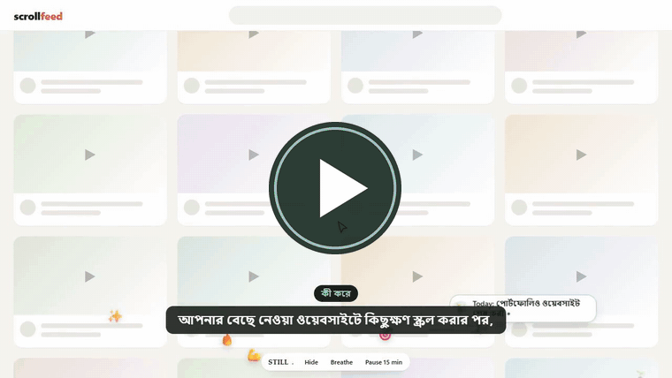

# STILL.

**Make progress. Without the pressure.**
*Your goals are still waiting for you.*

<p align="center">
  <a href="docs/still-intro-bn.mp4">
    
  </a>
</p>

<p align="center">
  ▶️ <b><a href="docs/still-intro-bn.mp4">পুরো ভিডিও দেখুন (বাংলা, ~৪ মিনিট)</a></b> — কেন STILL., কী কী করে, আর নিজের ব্রাউজারে শুরু থেকে শেষ পর্যন্ত সেটআপ।<br>
  <sub>Full walkthrough video in Bangla · <a href="docs/video-script-bn.md">স্ক্রিপ্ট পড়ুন / Read the script</a> · <a href="https://github.com/rafi0112/still-browser-extension/raw/main/docs/still-intro-bn.mp4">Download MP4</a></sub>
</p>

### দ্রুত সেটআপ (বাংলা)

1. উপরের সবুজ **Code** বাটন → **Download ZIP** → ফাইলটি আনজিপ করে একটা স্থায়ী ফোল্ডারে রাখুন।
2. Chrome-এ `chrome://extensions` (Edge-এ `edge://extensions`) খুলে **Developer mode** চালু করুন।
3. **Load unpacked** চাপুন → যে ফোল্ডারে `manifest.json` আছে সেটা সিলেক্ট করুন।
4. সেটআপ উইজার্ড নিজে থেকে খুলবে — ওয়েবসাইট, অ্যানিমেশন, ইমোজি, নিজের বার্তা আর সময় বেছে **Finish Setup** চাপুন।
5. 🧩 পাজল আইকন থেকে STILL. পিন করে নিন।

STILL. is a mindful-browsing extension for Chrome and Microsoft Edge (Manifest V3). On the websites you choose, it floats gentle, animated reminders up the screen — your own sentences, a few emojis — the way reactions drift up a live stream. It never blocks a page, closes a tab or forces a break. Everything stays on your device.

---

## Install (Load unpacked)

1. Open **Chrome** → `chrome://extensions` or **Edge** → `edge://extensions`.
2. Turn on **Developer mode** (top-right in Chrome, left sidebar in Edge).
3. Click **Load unpacked** and pick the `still-extension` folder (the one that contains `manifest.json`).
4. The setup wizard opens in a new tab automatically. (If it doesn't, click the STILL. icon → **Start setup**.)
5. Pick your websites, allow access when the browser asks, then choose styles, emojis, messages and rhythm.
6. Press **Finish Setup**. STILL. is now active on those websites.
7. Optional: click the puzzle icon in the toolbar and pin STILL.

Requires Chrome / Edge 111 or newer.

---

## New in 1.1

| Feature | Where |
|---|---|
| **Realistic 3D emojis** — 42 glossy 3D reactions in five groups (Growth, Energy, Focus, Achievement, Love & calm). Switch to system emoji any time. | Settings › Emojis |
| **Studio** — upload, drag-drop or paste (Ctrl+V) any picture; crop to circle / rounded / square, zoom & drag, sticker outline, remove white background. Use it as a floating **reaction**, as the **bubble icon** beside messages, or as **your logo** on the controls and check-in card. | Settings › Studio, or the **+** tile in Emojis |
| **Insights** — today’s time on your chosen sites, a 7-day rhythm chart, mindful moments, focus sessions, breathing breaks and a mindful streak. 60 days, on this device only. | Settings › Insights, popup |
| **Daily plans** — give any site a soft time plan (e.g. 30 min/day). When reached, one gentle check-in appears. Never a block. | Insights or Websites |
| **Focus sessions** — 15–90 min. STILL. greets you the moment you open a distracting site (“25 min to go — this can wait”), checks in twice as often, and shows a countdown on the toolbar badge. | Popup, Settings › Focus & Hours |
| **Today’s intention** — one line (“Ship the portfolio site”) shown in the popup and woven into today’s reminders; resets tomorrow. | Popup, Focus & Hours |
| **Breathing moment** — a one-minute guided breathing orb (in 4 · hold 2 · out 6), from the dock, the check-in card, the popup, or Alt+Shift+B. | Anywhere |
| **Active hours** — only remind on chosen days and times (overnight windows supported). | Focus & Hours |
| **Quick capture** — select text on any page → right-click → *Add to STILL. messages*. | Context menu |
| **Shortcuts** — Alt+Shift+S open · Alt+Shift+P pause/resume · Alt+Shift+Y preview · Alt+Shift+B breathe (change at `chrome://extensions/shortcuts`). | Keyboard |
| **New looks** — *Frosted Glass* and *Aurora* presets, bubble-icon choice, redesigned popup. | Appearance |

How images are shown on websites: STILL. never inserts `` into a page. The bytes go through the service worker (bundled art) or extension storage (your images), are decoded with `createImageBitmap` and painted on a `<canvas>` inside the closed shadow root — so strict site security policies can’t break them and pages can’t detect the extension’s files.

3D emoji artwork: [Microsoft Fluent Emoji](https://github.com/microsoft/fluentui-emoji), MIT licence (`assets/emoji/LICENSE-fluentui-emoji.txt`).

---

## What's inside

```
still-extension/
├─ manifest.json
├─ background/
│  ├─ service-worker.js     install flow, dynamic content-script registration, messaging, pause alarm, badge
│  ├─ session-manager.js    per-site session clock in chrome.storage.session (survives reloads + SW restarts)
│  ├─ message-scheduler.js  decides when a wave is due and its escalation stage
│  └─ stats.js              local insights: daily per-site time, moments, focus
├─ content/
│  ├─ content.js            entry: duplicate/orphan guard, heartbeat, live settings, previews
│  ├─ overlay.js            closed Shadow DOM host, dismiss dock, check-in card
│  ├─ animation-engine.js   keyframe engine: placement, stagger, caps, cleanup, reduced motion
│  └─ overlay-styles.js     overlay CSS (as a string, so no web-accessible resource is exposed)
├─ shared/
│  ├─ defaults.js           schema, defaults, presets, styles, categories, default messages
│  ├─ utils.js              validation (domains, text, emoji), settings normaliser, helpers
│  ├─ storage.js            centralised settings manager over chrome.storage.local
│  ├─ message-engine.js     message/emoji selection, rotation and no-repeat logic
│  ├─ media.js              3D emoji + Studio images → canvas on sites / img on pages
│  ├─ studio.js             image uploader, cropper and gallery
│  ├─ insights.js           insights dashboard, focus, intention, active hours
│  ├─ ui.css / ui.js        design system + primitives for extension pages
│  └─ components.js         settings components shared by onboarding and options
├─ onboarding/              7-step setup wizard
├─ popup/                   toolbar popup
├─ options/                 full settings (8 tabs)
└─ assets/icons/
```

> Changes from the suggested layout: `message-engine.js` lives in `shared/` because the service worker (real waves) and every preview use it. The overlay stylesheet is shipped as `overlay-styles.js` so it can be injected into a closed shadow root without making a file web-accessible (which would let websites detect the extension). `ui.css`, `ui.js` and `components.js` were added so onboarding and options share the same controls.

### How the pieces talk

| From → To | Channel | Purpose |
|---|---|---|
| Any page → everyone | `chrome.storage.local` + `storage.onChanged` | **Settings sync.** Every write goes through `STILL.store` (normalised + validated). The popup, options, onboarding, service worker and every open tab — including background tabs — react to the change immediately. |
| Content → SW | `still:tick` | Heartbeat every ~15 s while the tab is visible. The SW adds active time to the site's session and, if a wave is due, builds it and returns it. Only the SW decides, so two tabs of one site never both fire. |
| Content / popup / options → SW | `still:pause`, `still:resume` | Writes `pausedUntil`, schedules an alarm to clear it, updates the badge. |
| Popup → SW | `still:session` | Current site's session time for the popup. |
| Popup → tab | `still:preview` (`tabs.sendMessage`) | Plays a wave now. If STILL. isn't on that page, the popup injects it once via `activeTab`. |
| Pages → SW | `still:sync` | Re-register content scripts after a permission change. |

**Content-script registration is dynamic.** The manifest requests no host access up front (`optional_host_permissions`). When you add a site, STILL. asks for access to just that domain; the service worker then registers its content scripts for enabled + permitted sites only (`chrome.scripting.registerContentScripts`) and injects into tabs that are already open. Nothing is registered until onboarding is finished, so no message ever appears before setup.

### Gentle escalation (defaults)

| Active time on a site | What happens |
|---|---|
| 0–5 min | Nothing |
| 5 min | A few floating emoji reactions |
| 8 min | One motivational sentence |
| every 3 min after | Your messages + emojis |
| 20 min | A soft check-in card ("You've been scrolling for a while…") with *Pause 15 min* / *Thanks, I'm on it* |

Turn escalation off in **Timing & Frequency** or **General** to make every appearance a regular one. Time only counts while the tab is visible (configurable). A site's session restarts after 30 minutes away (configurable), and survives normal page reloads.

### Permissions

| Permission | Why |
|---|---|
| `storage` | Save your settings locally. |
| `scripting` | Register the overlay only on the websites you chose. |
| `alarms` | End a pause on time. |
| `activeTab` | Let **Preview now** and the popup's current-site info work on the tab you're looking at. |
| `contextMenus` | The optional “Add selection to STILL. messages” menu item. |
| Optional host access (per site) | Draw the overlay on the sites you picked. Requested one domain at a time. |

No backend, no network requests, no analytics, no reading of page content or history. User text is always rendered with `textContent` and never interpreted as HTML.

---

## Testing checklist

**First run**
1. Load unpacked → the wizard opens by itself. Visit a site before finishing → nothing appears.
2. Step 2: press Continue with no site → validation message. Type `not a domain` → inline error. Add `news.ycombinator.com` or pick presets → Continue → the browser asks for access.
3. Steps 3–6: hover style cards (each animates), pick several, add an emoji (e.g. 🌊), write a personal sentence, adjust rhythm. The live preview replays on every change.
4. Step 7: Play / Check-in / change position and look → Finish Setup.

**Live behaviour** (to test quickly, set *Initial delay* to *Right away* and *Interval* to 30 sec in Settings → Timing)
5. Open a chosen site → reactions float up within a few seconds. Click links/buttons underneath — the overlay never blocks them, and the page doesn't shift.
6. With the site open, change appearance preset, position, animation style or messages in Settings → use the popup's **Preview now**: the change is already applied, no reload.
7. Reload the page → the popup's session timer continues instead of restarting.
8. Open the same site in two tabs → one shared session, no doubled waves.
9. Switch to another tab → the timer stops (with *Pause in background tabs* on).
10. Popup → **Pause 15 min** → badge shows `II`, nothing appears; **Resume** clears it. Master switch off → badge `off`.
11. Dock **Hide** clears the current wave; **Pause 15 min** pauses everywhere.
12. Disable every message → STILL. shows *"Your goals are still waiting for you."* and a warning appears in Settings.
13. Turn on your OS "reduce motion" setting (or Settings → General → Motion → Reduce) → items only fade, no travel.
14. Settings → Data & Privacy → Export, then Import the file; try importing a random JSON → rejected.
15. Popup on `chrome://extensions` → it explains STILL. only runs on regular websites; Preview reports it can't draw there.

---

## Troubleshooting

| Symptom | Fix |
|---|---|
| Nothing appears on a site | Check the popup: is STILL. on, not paused, and is *Floating messages here* on? In Settings → Websites, the site should show **Access granted** — if it shows **Allow access**, click it. Remember the default initial delay is 5 minutes of *visible* time. |
| Access was denied by mistake | Settings → Websites → **Allow access** on that row. |
| Wizard didn't open | Click the STILL. icon → **Start setup**, or open `onboarding/onboarding.html` via Settings → General → **Run setup again**. |
| After reloading the extension, an open tab doesn't show STILL. | Reload that tab once (old content scripts are cleaned up automatically; new ones are injected for newly added sites). |
| Messages feel too frequent | Settings → Timing → **Calm** preset, or raise *Interval* / lower *Emojis per appearance*. |
| Preview says the page doesn't allow it | Browser pages (`chrome://`, `edge://`), the Chrome Web Store / Edge Add-ons site and some PDF viewers can't be drawn on by any extension. |
| Want a clean slate | Settings → Data & Privacy → **Reset settings** (keeps websites) and **Reset timers**. Removing the extension deletes all of its data. |

---

## Privacy

STILL. stores settings in `chrome.storage.local` and session timers in `chrome.storage.session` (cleared when the browser closes). It has no server, sends nothing anywhere, uses no third-party code, and never reads the pages you visit.
